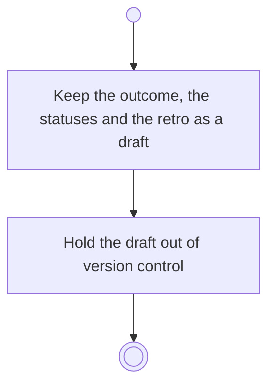

# BP07.02 — Draft the goal check-out

> GENERATED by `bpmn-dsl si-export` — do not edit; the source is the `call` block in the
> `.bpd` (#1182/ADR-068, keyed by call site per ADR-069).
>
> hash: `sha256:bd11c7504e62ee9f5282779773fccd59b28c6c273abde6f240a51f4681cdb221`

## BP07_CloseOutAGoal — Activity diagram

### Bound rules

| Where | Rule |
|---|---|
| Keep the outcome, the statuses and the retro as a draft | `BR-32` |
| Hold the draft out of version control | `BR-121` |

### Messages

| Where | Message | To | Payload |
|---|---|---|---|
| Draft the goal check-out | Draft kept | User | — |

### Notes

- **Draft the goal check-out**: A draft is not a commit. Nothing it describes takes effect until the check-out is completed.
