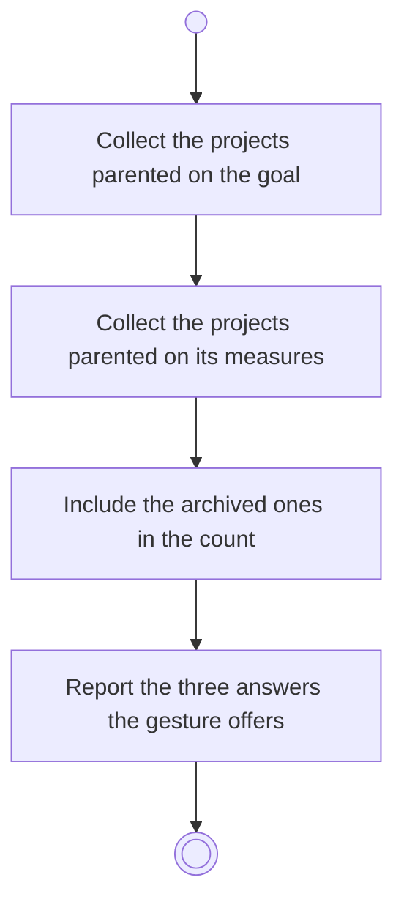

# BP07.03 — See what archiving the goal takes

> GENERATED by `bpmn-dsl si-export` — do not edit; the source is the `call` block in the
> `.bpd` (#1182/ADR-068, keyed by call site per ADR-069).
>
> hash: `sha256:123252b3b5418f85cdfcd587651093188be4ee210d2ed0dbcb0a40eb55e5ad7d`

## BP07_CloseOutAGoal — Activity diagram

### Bound rules

| Where | Rule |
|---|---|
| Include the archived ones in the count | `BR-117` |
| Report the three answers the gesture offers | `BR-112` |

### Messages

| Where | Message | To | Payload |
|---|---|---|---|
| See what archiving the goal takes | What the archiving will take | User | — |

### Notes

- **See what archiving the goal takes**: Cascade, the goal alone, or reject. The keep answer is legal here because an archived goal still exists.
