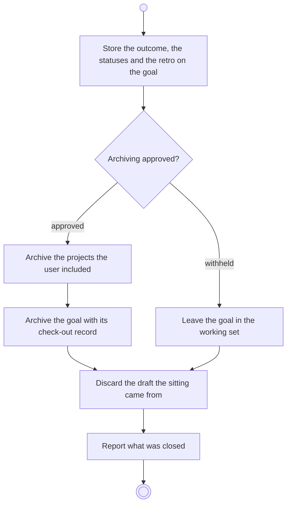

# BP07.04 — Close out the goal

> GENERATED by `bpmn-dsl si-export` — do not edit; the source is the `call` block in the
> `.bpd` (#1182/ADR-068, keyed by call site per ADR-069).
>
> hash: `sha256:910d369f378dcd328bcbf7ccd683d1f66ae6caaa42217965f8b8a58b52db31eb`

## BP07_CloseOutAGoal — Activity diagram

### Bound rules

| Where | Rule |
|---|---|
| Store the outcome, the statuses and the retro on the goal | `BR-27` |
| "Archiving approved?" | `BR-30` |
| Archive the projects the user included | `BR-112` |
| Archive the goal with its check-out record | `BR-23` |
| Discard the draft the sitting came from | `BR-121` |

### Messages

| Where | Message | To | Payload |
|---|---|---|---|
| Close out the goal | Goal checked out | User | — |

### Notes

- **Close out the goal**: The check-out record stays attached to the goal, archived or not, and unarchiving never revokes it.
