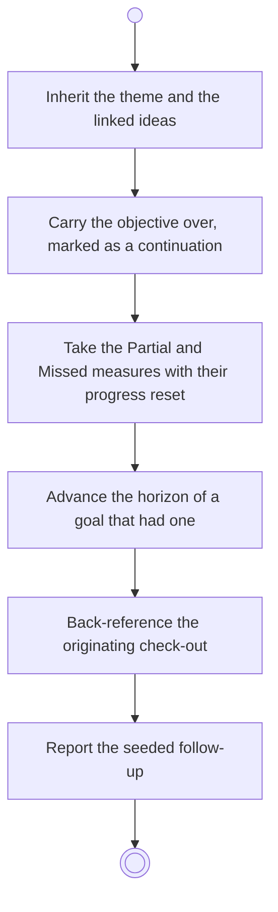

# BP07.05 — Seed a follow-up goal

> GENERATED by `bpmn-dsl si-export` — do not edit; the source is the `call` block in the
> `.bpd` (#1182/ADR-068, keyed by call site per ADR-069).
>
> hash: `sha256:9beb5343000dfc901aeebaf5426121527671a0cf047231db145569b90306294f`

## BP07_CloseOutAGoal — Activity diagram

### Bound rules

| Where | Rule |
|---|---|
| Inherit the theme and the linked ideas | `BR-31` |

### Messages

| Where | Message | To | Payload |
|---|---|---|---|
| Seed a follow-up goal | The seeded follow-up for review | User | — |

### Notes

- **Seed a follow-up goal**: Check-out notes are dropped. A goal that was open-ended stays open-ended. The seed is reviewed before anything is created.
