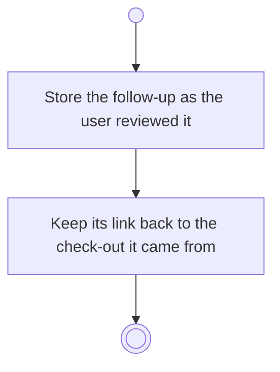

# BP07.06 — Create the follow-up goal

> GENERATED by `bpmn-dsl si-export` — do not edit; the source is the `call` block in the
> `.bpd` (#1182/ADR-068, keyed by call site per ADR-069).
>
> hash: `sha256:8ae85dc6f85869ab53b5522df4f5631ff84639c975c43c9c2f2220b38672dca8`

## BP07_CloseOutAGoal — Activity diagram

### Bound rules

| Where | Rule |
|---|---|
| Store the follow-up as the user reviewed it | `BR-31` |

### Messages

| Where | Message | To | Payload |
|---|---|---|---|
| Create the follow-up goal | Follow-up goal created | User | — |

### Notes

- **Create the follow-up goal**: The iteration chain stays traceable from the follow-up back to the check-out.
