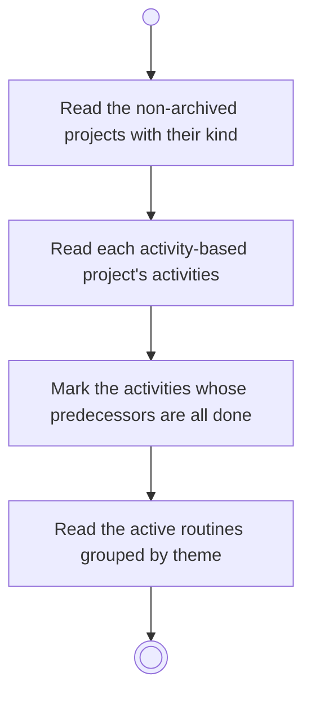

# BP08.01 — Read the day's selectables

> GENERATED by `bpmn-dsl si-export` — do not edit; the source is the `call` block in the
> `.bpd` (#1182/ADR-068, keyed by call site per ADR-069).
>
> hash: `sha256:59114933f2155ffeb2fa65500997fcd0ed03a3c5f8da2a445be5272fd46117a1`

## BP08_SetADaysFocus — Activity diagram

### Bound rules

| Where | Rule |
|---|---|
| Read the non-archived projects with their kind | `BR-43` |
| Mark the activities whose predecessors are all done | `BR-99` |
| Read the active routines grouped by theme | `BR-43` |

### Messages

| Where | Message | To | Payload |
|---|---|---|---|
| Read the day's selectables | Selectable boards and routines | User | — |

### Notes

- **Read the day's selectables**: Archived projects and paused routines are not offered. A ready activity is one with no unfinished predecessor. Any date is focusable: a past day, today or a future day.
