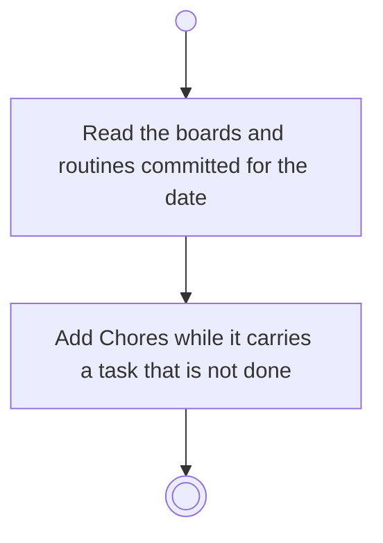

# BP08.03 — Read the day's focus

> GENERATED by `bpmn-dsl si-export` — do not edit; the source is the `call` block in the
> `.bpd` (#1182/ADR-068, keyed by call site per ADR-069).
>
> hash: `sha256:e80107ddec65a817b9f800a2c54b4de9ecd754608953830a75fa8b5a43e4da40`

## BP08_SetADaysFocus — Activity diagram

### Bound rules

| Where | Rule |
|---|---|
| Add Chores while it carries a task that is not done | `BR-107` |

### Messages

| Where | Message | To | Payload |
|---|---|---|---|
| Read the day's focus | The day's focus as committed | User | — |

### Notes

- **Read the day's focus**: The Chores membership is derived at read time and never stored.
