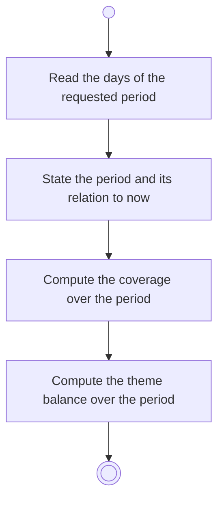

# BP09.01 — Read a period overview

> GENERATED by `bpmn-dsl si-export` — do not edit; the source is the `call` block in the
> `.bpd` (#1182/ADR-068, keyed by call site per ADR-069).
>
> hash: `sha256:ab7480e61691efecbdc23c5523f4b145c8ef3dfbb781e8ec7d99cefd6c5c340c`

## BP09_ReviewFocusHistory — Activity diagram

### Bound rules

| Where | Rule |
|---|---|
| Read the days of the requested period | `BR-93` |
| State the period and its relation to now | `BR-46` |
| Compute the theme balance over the period | `BR-47` |

### Messages

| Where | Message | To | Payload |
|---|---|---|---|
| Read a period overview | The period with its coverage and theme balance | User | — |

### Notes

- **Read a period overview**: One read serves week, month and year, and serves previous, next and current alike. There is no day-scoped view. The Chores board is absent from history: a derived member cannot be reconstructed for a past date.
