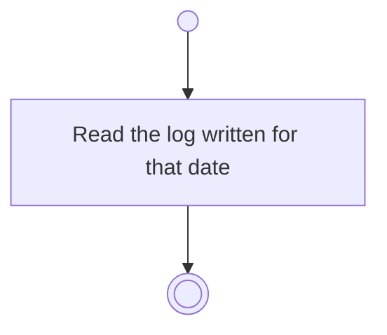

# BP09.02 — Read a day's log

> GENERATED by `bpmn-dsl si-export` — do not edit; the source is the `call` block in the
> `.bpd` (#1182/ADR-068, keyed by call site per ADR-069).
>
> hash: `sha256:af4329c9e1e95488bd498b72b8c793004974d6d90cffe3f4fe3b98466bdf7267`

## BP09_ReviewFocusHistory — Activity diagram

### Bound rules

| Where | Rule |
|---|---|
| Read the log written for that date | `BR-38` |

### Messages

| Where | Message | To | Payload |
|---|---|---|---|
| Read a day's log | That day's log | User | — |

### Notes

- **Read a day's log**: The log holds what was completed, what was still open, and the notes written that day.
