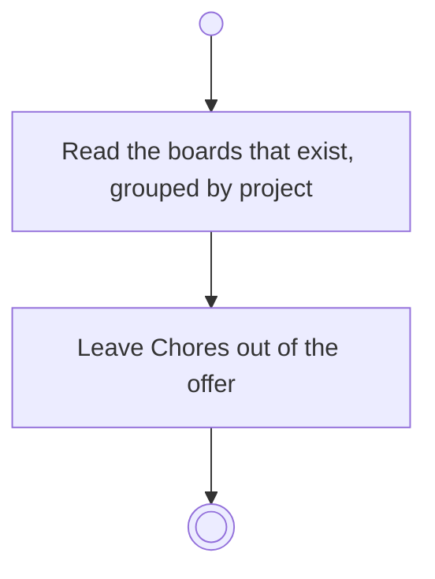

# BP10.01 — Read the selectable boards

> GENERATED by `bpmn-dsl si-export` — do not edit; the source is the `call` block in the
> `.bpd` (#1182/ADR-068, keyed by call site per ADR-069).
>
> hash: `sha256:1e2b6abdc5b22fa81b3763ad5cbd4acc18aacd2f3be4b932191692bc8415c22a`

## BP10_CaptureTasks — Activity diagram

### Bound rules

| Where | Rule |
|---|---|
| Read the boards that exist, grouped by project | `BR-103` |
| Leave Chores out of the offer | `BR-62` |

### Messages

| Where | Message | To | Payload |
|---|---|---|---|
| Read the selectable boards | The boards that exist | User | — |

### Notes

- **Read the selectable boards**: Chores is never a destination the user picks. Naming no board at all is what sends a task there. The answer is empty until the first project exists, and then naming no board is the only legal capture.
