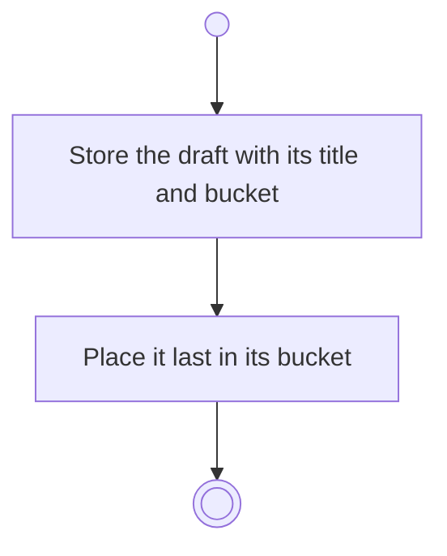

# BP10.02 — Stage a task draft

> GENERATED by `bpmn-dsl si-export` — do not edit; the source is the `call` block in the
> `.bpd` (#1182/ADR-068, keyed by call site per ADR-069).
>
> hash: `sha256:2f406699de5bf00aac979b164a009417bcd2caeffb1210264d68216880045eae`

## BP10_CaptureTasks — Activity diagram

### Bound rules

| Where | Rule |
|---|---|
| Store the draft with its title and bucket | `BR-53` |

### Messages

| Where | Message | To | Payload |
|---|---|---|---|
| Stage a task draft | Draft staged | User | — |

### Notes

- **Stage a task draft**: A staged draft is not a commit. It is kept outside version control.
