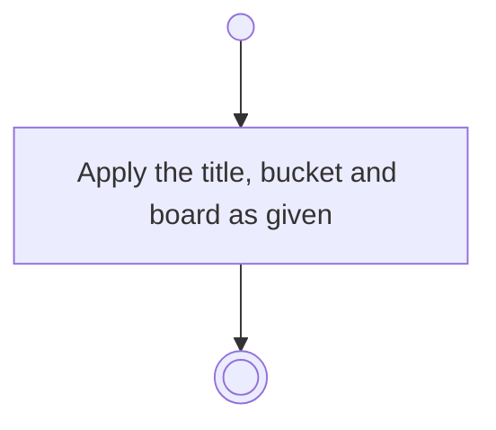

# BP10.03 — Amend a staged draft

> GENERATED by `bpmn-dsl si-export` — do not edit; the source is the `call` block in the
> `.bpd` (#1182/ADR-068, keyed by call site per ADR-069).
>
> hash: `sha256:9fd47b594f60c62771e282a176e1a22449d50ff7107037891b5cdada770d0fd9`

## BP10_CaptureTasks — Activity diagram

### Messages

| Where | Message | To | Payload |
|---|---|---|---|
| Amend a staged draft | Draft amended | User | — |
