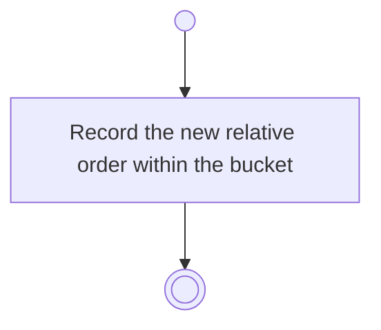

# BP10.04 — Reorder staged drafts

> GENERATED by `bpmn-dsl si-export` — do not edit; the source is the `call` block in the
> `.bpd` (#1182/ADR-068, keyed by call site per ADR-069).
>
> hash: `sha256:ab6fd66ae5bb9220d0b3e609aeb11b01b24605e5ae713363c247b15bf4857fa4`

## BP10_CaptureTasks — Activity diagram

### Messages

| Where | Message | To | Payload |
|---|---|---|---|
| Reorder staged drafts | Order recorded | User | — |
