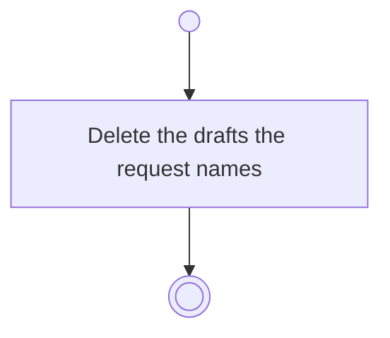

# BP10.05 — Discard staged drafts

> GENERATED by `bpmn-dsl si-export` — do not edit; the source is the `call` block in the
> `.bpd` (#1182/ADR-068, keyed by call site per ADR-069).
>
> hash: `sha256:3af151b40d19e6c878c51bc56cc802a39e614bbf7e56f2f4625d3c78f98b5764`

## BP10_CaptureTasks — Activity diagram

### Messages

| Where | Message | To | Payload |
|---|---|---|---|
| Discard staged drafts | Drafts discarded | User | — |

### Notes

- **Discard staged drafts**: One request discards a single draft and the whole batch alike.
