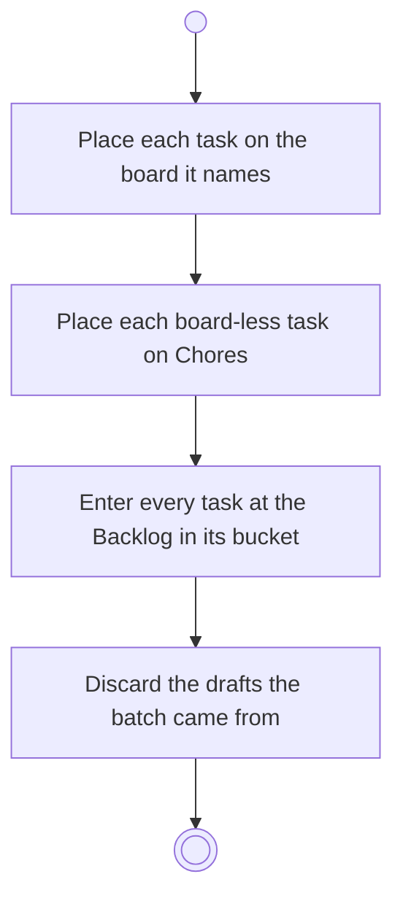

# BP10.06 — Commit the staged tasks

> GENERATED by `bpmn-dsl si-export` — do not edit; the source is the `call` block in the
> `.bpd` (#1182/ADR-068, keyed by call site per ADR-069).
>
> hash: `sha256:93bddfe3a42f2368d47604e0fe7dd34be9284aeb2047c413f4d86208cc7457ac`

## BP10_CaptureTasks — Activity diagram

### Bound rules

| Where | Rule |
|---|---|
| Place each task on the board it names | `BR-103` |
| Place each board-less task on Chores | `BR-90` |
| Enter every task at the Backlog in its bucket | `BR-55` |

### Messages

| Where | Message | To | Payload |
|---|---|---|---|
| Commit the staged tasks | Tasks on their boards | User | — |

### Notes

- **Commit the staged tasks**: Capturing a task never creates a board. The batch commits as one act.
