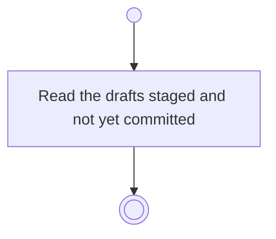

# BP10.07 — Read the staged batch

> GENERATED by `bpmn-dsl si-export` — do not edit; the source is the `call` block in the
> `.bpd` (#1182/ADR-068, keyed by call site per ADR-069).
>
> hash: `sha256:221d9fc1891f33ae15f6b9190f4a043bf32d74c1509c3199e7c7e1021ddb7bd5`

## BP10_CaptureTasks — Activity diagram

### Messages

| Where | Message | To | Payload |
|---|---|---|---|
| Read the staged batch | The staged batch, if any | User | — |

### Notes

- **Read the staged batch**: The answer is empty where nothing was left staged. A draft is kept outside version control.
