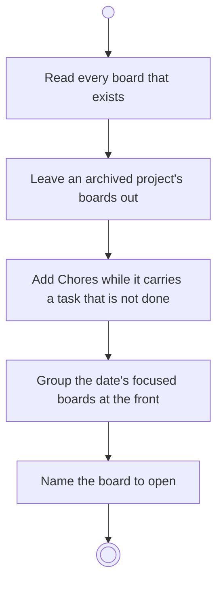

# BP11.01 — Read the boards in play

> GENERATED by `bpmn-dsl si-export` — do not edit; the source is the `call` block in the
> `.bpd` (#1182/ADR-068, keyed by call site per ADR-069).
>
> hash: `sha256:ca68a4feeaa931a587e7f091da77b3c4e356e5b47e126877a653e30bb3cbb8d1`

## BP11_WorkTheBoard — Activity diagram

### Bound rules

| Where | Rule |
|---|---|
| Read every board that exists | `BR-49` |
| Leave an archived project's boards out | `BR-43` |
| Add Chores while it carries a task that is not done | `BR-107` |
| Group the date's focused boards at the front | `BR-116` |
| Name the board to open | `BR-51` |

### Messages

| Where | Message | To | Payload |
|---|---|---|---|
| Read the boards in play | The board strip, focus first | User | — |

### Notes

- **Read the boards in play**: The strip holds every board and the focus orders it. An out-of-focus activity-based project is one entry, opening to its activities on demand. Where the date has no focus, the first board in the strip is the one named.
