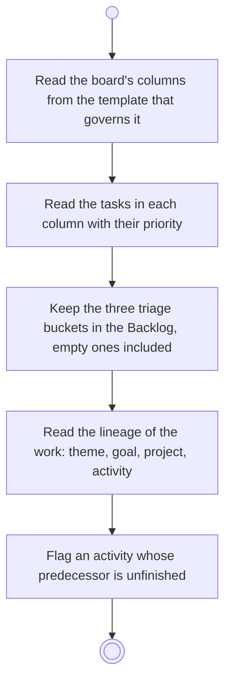

# BP11.02 — Read a board

> GENERATED by `bpmn-dsl si-export` — do not edit; the source is the `call` block in the
> `.bpd` (#1182/ADR-068, keyed by call site per ADR-069).
>
> hash: `sha256:eae4a931537b9417dab97b86e58afc5d4b35773713e2560777732c110fe40234`

## BP11_WorkTheBoard — Activity diagram

### Bound rules

| Where | Rule |
|---|---|
| Read the board's columns from the template that governs it | `BR-108` |
| Read the tasks in each column with their priority | `BR-54` |
| Keep the three triage buckets in the Backlog, empty ones included | `BR-57` |
| Flag an activity whose predecessor is unfinished | `BR-110` |

### Messages

| Where | Message | To | Payload |
|---|---|---|---|
| Read a board | The board with its columns, cards and lineage | User | — |

### Notes

- **Read a board**: A board with no tasks is an empty board, not an empty page. A project's template governs its boards; the Chores board owns its template itself. The flag on an unfinished predecessor names it and clears itself when that predecessor completes.
