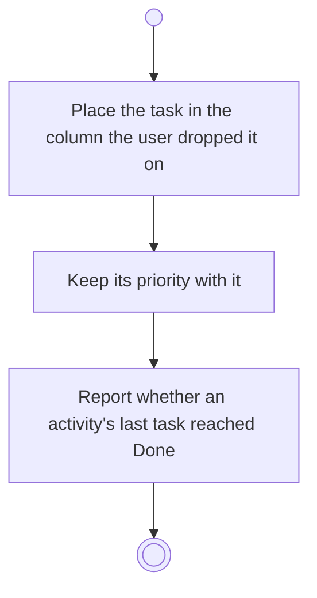

# BP11.03 — Move a task

> GENERATED by `bpmn-dsl si-export` — do not edit; the source is the `call` block in the
> `.bpd` (#1182/ADR-068, keyed by call site per ADR-069).
>
> hash: `sha256:df0702acd59ffcea08e55cc23057eefa4558bb492f52af1dbe4a6c7b20bdafe8`

## BP11_WorkTheBoard — Activity diagram

### Bound rules

| Where | Rule |
|---|---|
| Place the task in the column the user dropped it on | `BR-64` |
| Keep its priority with it | `BR-54` |
| Report whether an activity's last task reached Done | `BR-109` |

### Messages

| Where | Message | To | Payload |
|---|---|---|---|
| Move a task | Task moved | User | — |

### Notes

- **Move a task**: One request moves a task between columns and sends it back to the Backlog alike. A task never moves to another board. Returning it to the Backlog re-opens its triage.
