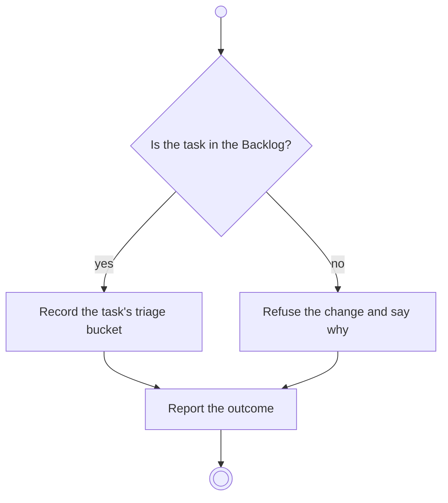

# BP11.04 — Prioritize a task

> GENERATED by `bpmn-dsl si-export` — do not edit; the source is the `call` block in the
> `.bpd` (#1182/ADR-068, keyed by call site per ADR-069).
>
> hash: `sha256:227954948baece355674e4c591f4fb7eb9070c393fda63cecde35d4f6891d1ea`

## BP11_WorkTheBoard — Activity diagram

### Bound rules

| Where | Rule |
|---|---|
| "Is the task in the Backlog?" | `BR-56` |
| Record the task's triage bucket | `BR-53` |

### Messages

| Where | Message | To | Payload |
|---|---|---|---|
| Prioritize a task | Priority recorded | User | — |

### Notes

- **Prioritize a task**: Triage happens at intake, so priority lives in the Backlog. The buckets are Important and Urgent, Not Important and Urgent, and Important and Not Urgent.
