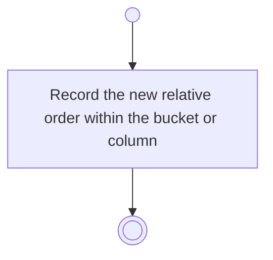

# BP11.05 — Rank a task

> GENERATED by `bpmn-dsl si-export` — do not edit; the source is the `call` block in the
> `.bpd` (#1182/ADR-068, keyed by call site per ADR-069).
>
> hash: `sha256:1e95718ee0a440278f2980efdc2573a75c39a80686fc3320e23b6ff9eb7dbaef`

## BP11_WorkTheBoard — Activity diagram

### Messages

| Where | Message | To | Payload |
|---|---|---|---|
| Rank a task | Rank recorded | User | — |
