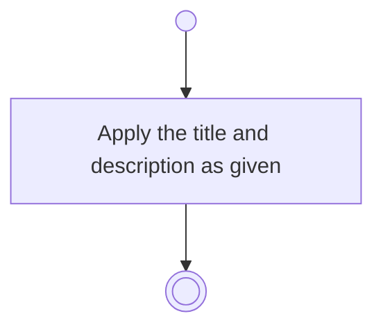

# BP11.06 — Amend a task

> GENERATED by `bpmn-dsl si-export` — do not edit; the source is the `call` block in the
> `.bpd` (#1182/ADR-068, keyed by call site per ADR-069).
>
> hash: `sha256:0c6ed0ff10ea958c3ebca03a25621b3370849c03c9fb68ade41ff2d81dd8de74`

## BP11_WorkTheBoard — Activity diagram

### Bound rules

| Where | Rule |
|---|---|
| Apply the title and description as given | `BR-64` |

### Messages

| Where | Message | To | Payload |
|---|---|---|---|
| Amend a task | Task amended | User | — |

### Notes

- **Amend a task**: The board and the column are untouched by an amendment.
