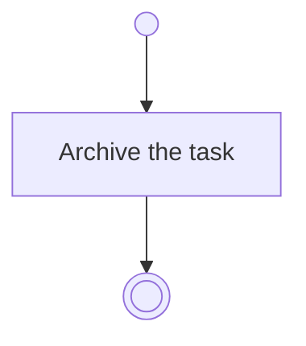

# BP11.07 — Archive a task

> GENERATED by `bpmn-dsl si-export` — do not edit; the source is the `call` block in the
> `.bpd` (#1182/ADR-068, keyed by call site per ADR-069).
>
> hash: `sha256:d4ff1ce25c583c496d98b664bd0ba3c1347f8ae4a623c37561c40a3124b9e17a`

## BP11_WorkTheBoard — Activity diagram

### Bound rules

| Where | Rule |
|---|---|
| Archive the task | `BR-23` |

### Messages

| Where | Message | To | Payload |
|---|---|---|---|
| Archive a task | Task archived | User | — |

### Notes

- **Archive a task**: This is one of the three acts that archive a task, and the one that takes a single card. A routine's task archives by these same acts and no others.
