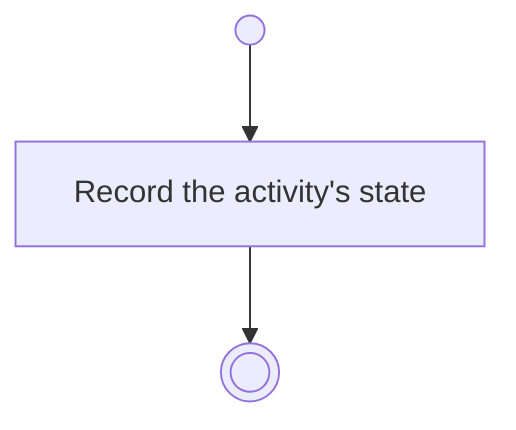

# BP11.09 — Set the activity Done

> GENERATED by `bpmn-dsl si-export` — do not edit; the source is the `call` block in the
> `.bpd` (#1182/ADR-068, keyed by call site per ADR-069).
>
> hash: `sha256:e53ec5858c614ffe6208a9ea4c08cf3e20f6d73fa8ad6ec2378625c8c429c4cc`

## BP11_WorkTheBoard — Activity diagram

### Bound rules

| Where | Rule |
|---|---|
| Record the activity's state | `BR-109` |

### Messages

| Where | Message | To | Payload |
|---|---|---|---|
| Set the activity Done | Activity state recorded | User | — |

### Notes

- **Set the activity Done**: The Course page owns an activity's state; this is the completion offer answered from the board. A Done activity can be reopened there.
