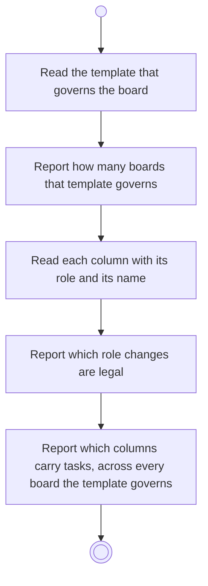

# BP12.01 — Read the column template

> GENERATED by `bpmn-dsl si-export` — do not edit; the source is the `call` block in the
> `.bpd` (#1182/ADR-068, keyed by call site per ADR-069).
>
> hash: `sha256:24f309747e0b9ea4a5f990e4a7f2546fda8058c689eac9ef291e4fbde45d52d3`

## BP12_ManageBoardColumns — Activity diagram

### Bound rules

| Where | Rule |
|---|---|
| Read the template that governs the board | `BR-108` |
| Report how many boards that template governs | `BR-97` |
| Read each column with its role and its name | `BR-58` |
| Report which role changes are legal | `BR-60` |

### Messages

| Where | Message | To | Payload |
|---|---|---|---|
| Read the column template | The columns with their roles and what may change | User | — |

### Notes

- **Read the column template**: The Backlog column's role is reported as fixed, and a Done column's as changeable only while another Done column remains. The user is told what may change instead of being refused after the fact. An activity-based project's template governs one board per activity, so the count says how far any change here reaches.
