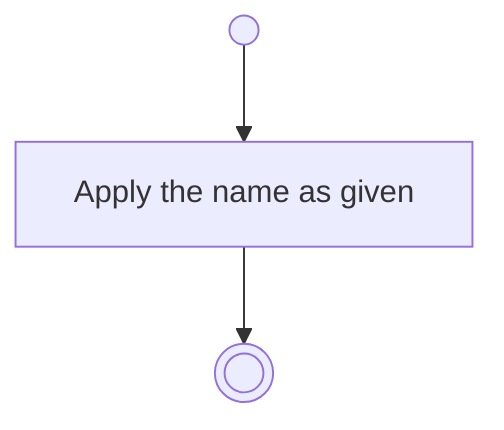

# BP12.02 — Rename a column

> GENERATED by `bpmn-dsl si-export` — do not edit; the source is the `call` block in the
> `.bpd` (#1182/ADR-068, keyed by call site per ADR-069).
>
> hash: `sha256:5bfeddafbf9320156748f534d931267f3e1f22dafa04c83dd74cedc95bbecb46`

## BP12_ManageBoardColumns — Activity diagram

### Bound rules

| Where | Rule |
|---|---|
| Apply the name as given | `BR-58` |

### Messages

| Where | Message | To | Payload |
|---|---|---|---|
| Rename a column | Column renamed | User | — |

### Notes

- **Rename a column**: The role is untouched. Day check-out and the advisor read the role, never the name.
