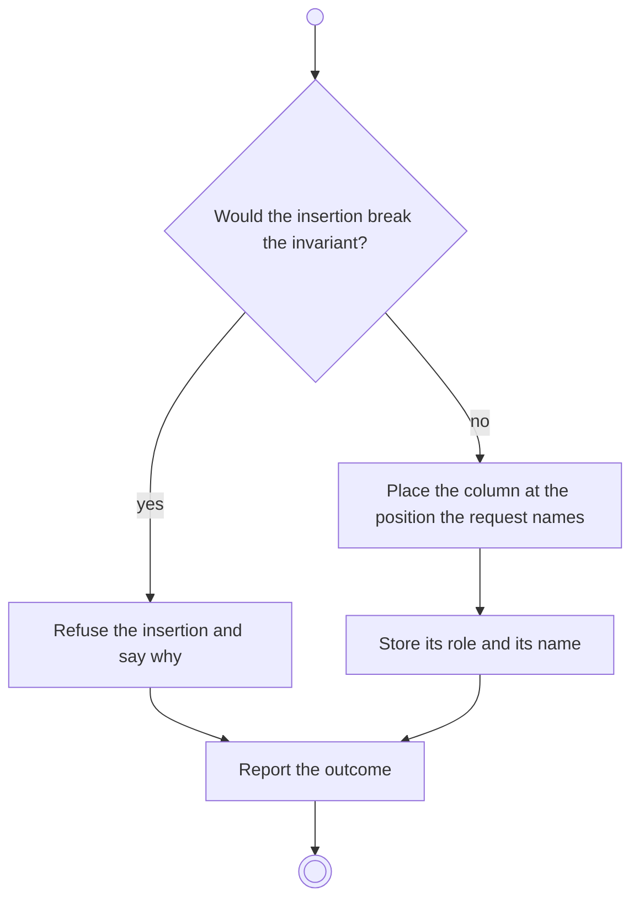

# BP12.03 — Insert a column

> GENERATED by `bpmn-dsl si-export` — do not edit; the source is the `call` block in the
> `.bpd` (#1182/ADR-068, keyed by call site per ADR-069).
>
> hash: `sha256:e8570b1c09033d90dfa90356776a7e1e4b0a6bc9d0120f41cbfdf3922ad766a5`

## BP12_ManageBoardColumns — Activity diagram

### Bound rules

| Where | Rule |
|---|---|
| "Would the insertion break the invariant?" | `BR-59` |
| Store its role and its name | `BR-58` |

### Messages

| Where | Message | To | Payload |
|---|---|---|---|
| Insert a column | Column inserted | User | — |

### Notes

- **Insert a column**: One Backlog column and at least one Done column, enforced once per template rather than once per board. A second Backlog is refused with its reason. The new lane appears on every board the template governs.
