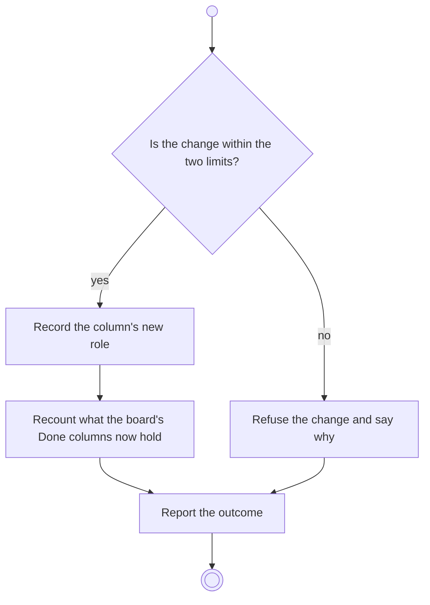

# BP12.05 — Change a column's role

> GENERATED by `bpmn-dsl si-export` — do not edit; the source is the `call` block in the
> `.bpd` (#1182/ADR-068, keyed by call site per ADR-069).
>
> hash: `sha256:3bca1eda166e1145c78370f7515e785aa94f1b6dfe2637f4560d9610d732932f`

## BP12_ManageBoardColumns — Activity diagram

### Bound rules

| Where | Rule |
|---|---|
| "Is the change within the two limits?" | `BR-60` |
| Record the column's new role | `BR-58` |
| Refuse the change and say why | `BR-59` |

### Messages

| Where | Message | To | Payload |
|---|---|---|---|
| Change a column's role | Role recorded | User | — |

### Notes

- **Change a column's role**: The Backlog role never changes. The last Done column cannot leave the role. Within those limits the consequences are the user's.
