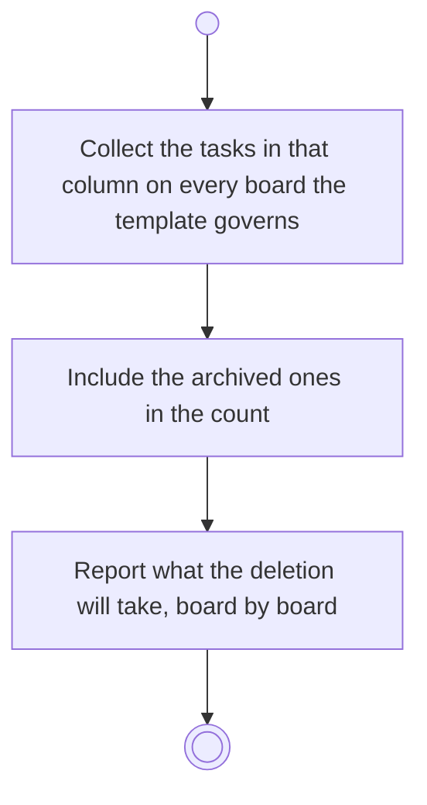

# BP12.07 — See what deleting a column takes

> GENERATED by `bpmn-dsl si-export` — do not edit; the source is the `call` block in the
> `.bpd` (#1182/ADR-068, keyed by call site per ADR-069).
>
> hash: `sha256:898fc03f981c534d8bddabdd14b56b20f4649bb154333ae7f7e9a3b5738cf089`

## BP12_ManageBoardColumns — Activity diagram

### Bound rules

| Where | Rule |
|---|---|
| Collect the tasks in that column on every board the template governs | `BR-108` |
| Include the archived ones in the count | `BR-117` |
| Report what the deletion will take, board by board | `BR-18` |

### Messages

| Where | Message | To | Payload |
|---|---|---|---|
| See what deleting a column takes | What the deletion will take | User | — |

### Notes

- **See what deleting a column takes**: A task cannot be left without a column, so the cascade is approve-or-abandon and detaching is not offered. Deleting a lane deletes it on every board the template governs, so the disclosure counts all of them. A column empty everywhere has nothing to disclose and deletes cleanly.
