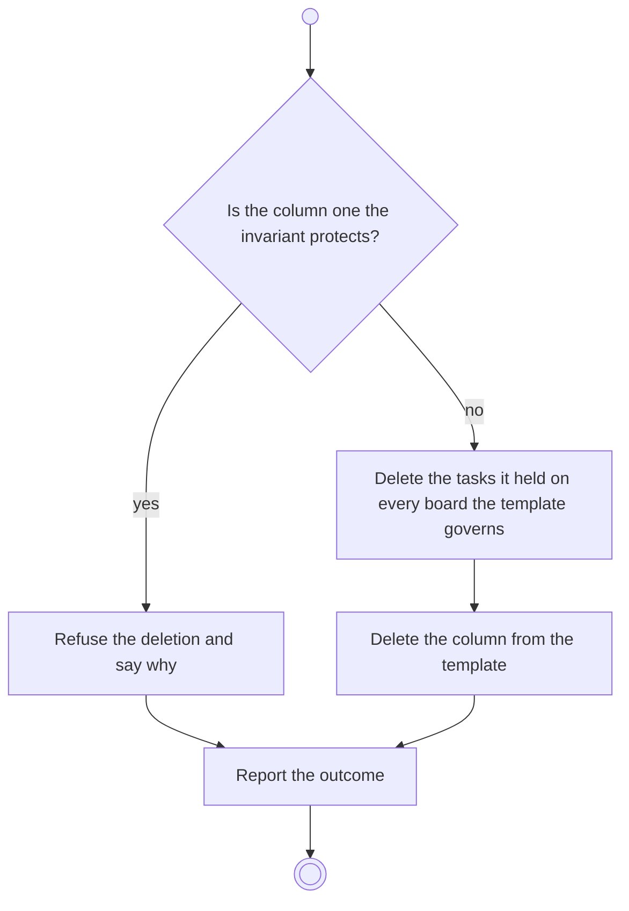

# BP12.08 — Delete a column

> GENERATED by `bpmn-dsl si-export` — do not edit; the source is the `call` block in the
> `.bpd` (#1182/ADR-068, keyed by call site per ADR-069).
>
> hash: `sha256:4975b3d4aafa9a72145174c2143ec95b09fdf7b4722b92cf4c85a91c70df1d05`

## BP12_ManageBoardColumns — Activity diagram

### Bound rules

| Where | Rule |
|---|---|
| "Is the column one the invariant protects?" | `BR-59` |
| Delete the tasks it held on every board the template governs | `BR-18` |
| Delete the column from the template | `BR-108` |

### Messages

| Where | Message | To | Payload |
|---|---|---|---|
| Delete a column | Column deleted | User | — |

### Notes

- **Delete a column**: The Backlog column and the last Done column are refused with their reason, for the same reason their roles cannot change.
