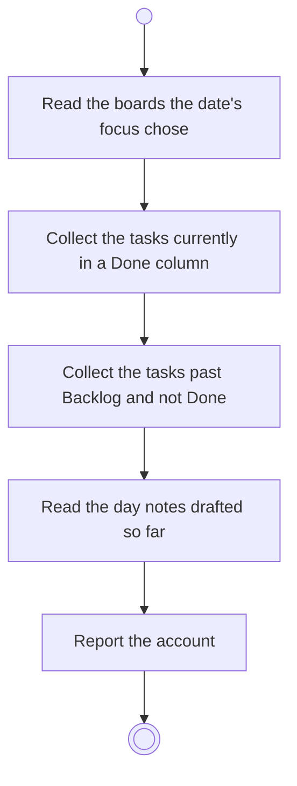

# BP13.01 — Read the day's account

> GENERATED by `bpmn-dsl si-export` — do not edit; the source is the `call` block in the
> `.bpd` (#1182/ADR-068, keyed by call site per ADR-069).
>
> hash: `sha256:b26e22c2d55859e179f3fa6faab6afd2d1f9007bb79ea9c7711d7aa18f81901f`

## BP13_CloseOutTheDay — Activity diagram

### Bound rules

| Where | Rule |
|---|---|
| Read the boards the date's focus chose | `BR-33` |
| Collect the tasks past Backlog and not Done | `BR-35` |
| Read the day notes drafted so far | `BR-37` |
| Report the account | `BR-39` |

### Messages

| Where | Message | To | Payload |
|---|---|---|---|
| Read the day's account | What is done and what is still open | User | — |

### Notes

- **Read the day's account**: Chores is out of the account even while it is in play: a chore being done is not progress on what was committed to. A date with no focus has an empty account. A date never checked out stays checkable out.
