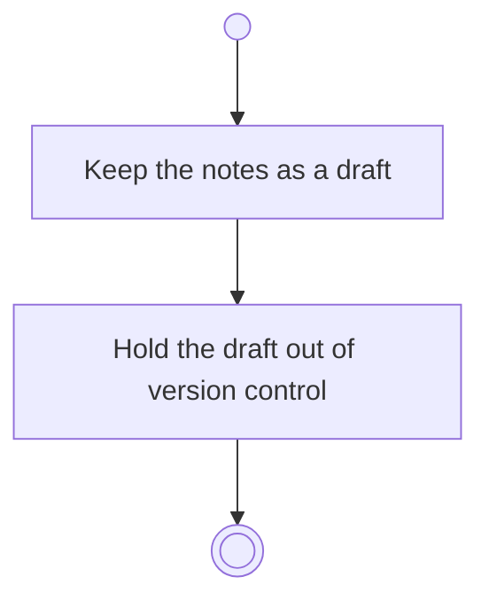

# BP13.02 — Draft the day notes

> GENERATED by `bpmn-dsl si-export` — do not edit; the source is the `call` block in the
> `.bpd` (#1182/ADR-068, keyed by call site per ADR-069).
>
> hash: `sha256:ac397297e8265263ce5e07a7a081966912f32e6d7fcb1c52491159453143c558`

## BP13_CloseOutTheDay — Activity diagram

### Bound rules

| Where | Rule |
|---|---|
| Keep the notes as a draft | `BR-37` |
| Hold the draft out of version control | `BR-121` |

### Messages

| Where | Message | To | Payload |
|---|---|---|---|
| Draft the day notes | Notes drafted | User | — |

### Notes

- **Draft the day notes**: A draft is not a commit. The notes enter the day's log when the check-out completes.
