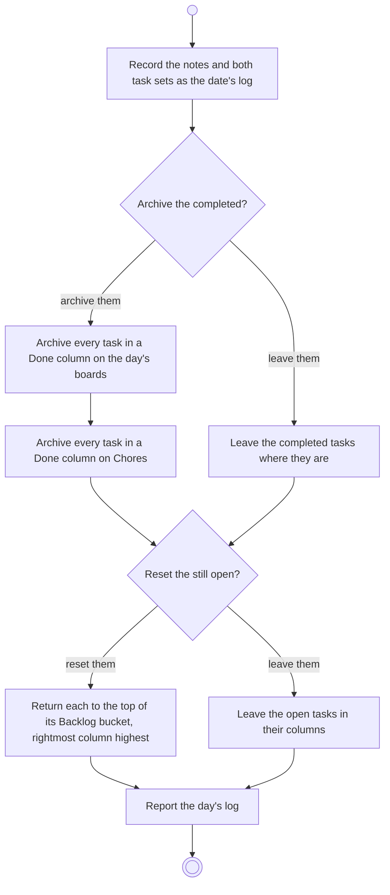

# BP13.03 — Close out the day

> GENERATED by `bpmn-dsl si-export` — do not edit; the source is the `call` block in the
> `.bpd` (#1182/ADR-068, keyed by call site per ADR-069).
>
> hash: `sha256:b20c53fdde1fa064d53d6ee5155d39ccc50e9de927163546781c2946e8290ac8`

## BP13_CloseOutTheDay — Activity diagram

### Bound rules

| Where | Rule |
|---|---|
| Record the notes and both task sets as the date's log | `BR-33` |
| "Archive the completed?" | `BR-34` |
| Archive every task in a Done column on the day's boards | `BR-23` |
| Archive every task in a Done column on Chores | `BR-34` |
| "Reset the still open?" | `BR-35` |
| Return each to the top of its Backlog bucket, rightmost column highest | `BR-54` |
| Report the day's log | `BR-36` |

### Messages

| Where | Message | To | Payload |
|---|---|---|---|
| Close out the day | The day's log | User | — |

### Notes

- **Close out the day**: The reset touches the day's chosen boards only. Chores tasks already archived by hand are simply not there to take. The log stays available as that day's explanation.
