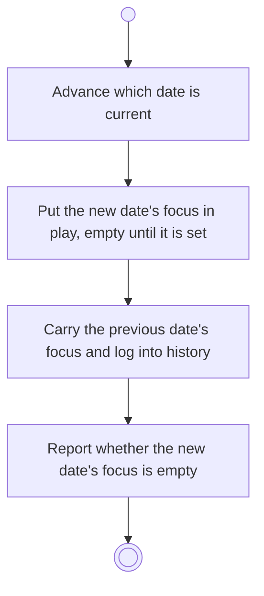

# BP14.01 — Roll the day over

> GENERATED by `bpmn-dsl si-export` — do not edit; the source is the `call` block in the
> `.bpd` (#1182/ADR-068, keyed by call site per ADR-069).
>
> hash: `sha256:060a5e1255884b0df4e41caf7e9a9ebcc9255a94498ac94a92d8e8a3f1126800`

## BP14_RollTheDayOver — Activity diagram

### Bound rules

| Where | Rule |
|---|---|
| Advance which date is current | `BR-44` |
| Put the new date's focus in play, empty until it is set | `BR-41` |
| Carry the previous date's focus and log into history | `BR-45` |
| Report whether the new date's focus is empty | `BR-40` |

### Messages

| Where | Message | To | Payload |
|---|---|---|---|
| Roll the day over | The day rolled over | User | — |

### Notes

- **Roll the day over**: Rollover creates nothing and destroys nothing: no task is spawned, nothing is archived and nothing is closed. A date never checked out stays checkable out. Chores follows the new date on its own while it carries work that is not done.
