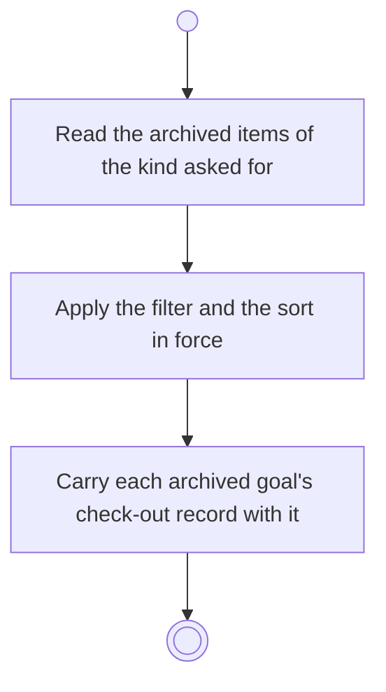

# BP15.01 — Read the archived items

> GENERATED by `bpmn-dsl si-export` — do not edit; the source is the `call` block in the
> `.bpd` (#1182/ADR-068, keyed by call site per ADR-069).
>
> hash: `sha256:1947715fb9460093a05724d34f32c52684d8e2426a38dc5eddc50bde4b92728f`

## BP15_ReviewArchivedMaterial — Activity diagram

### Bound rules

| Where | Rule |
|---|---|
| Read the archived items of the kind asked for | `BR-26` |
| Apply the filter and the sort in force | `BR-88` |
| Carry each archived goal's check-out record with it | `BR-30` |

### Messages

| Where | Message | To | Payload |
|---|---|---|---|
| Read the archived items | The archived items of that kind | User | — |

### Notes

- **Read the archived items**: One request serves all four archivable kinds: ideas, goals, projects and tasks. Archived material is retained on disk and reachable only this way.
