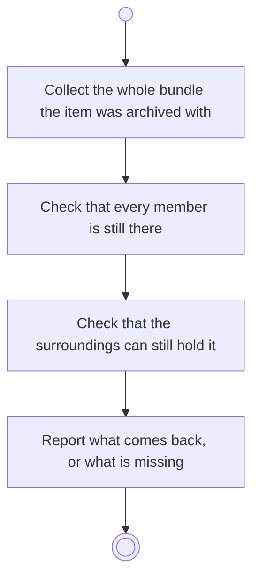

# BP15.02 — See what unarchiving will bring back

> GENERATED by `bpmn-dsl si-export` — do not edit; the source is the `call` block in the
> `.bpd` (#1182/ADR-068, keyed by call site per ADR-069).
>
> hash: `sha256:9c137b337b833b45b0749a5f3f7c1e4133fdf5b25cb7d9c21c898e6c0feca3dd`

## BP15_ReviewArchivedMaterial — Activity diagram

### Bound rules

| Where | Rule |
|---|---|
| Collect the whole bundle the item was archived with | `BR-25` |
| Report what comes back, or what is missing | `BR-25` |

### Messages

| Where | Message | To | Payload |
|---|---|---|---|
| See what unarchiving will bring back | What comes back, or why it cannot | User | — |

### Notes

- **See what unarchiving will bring back**: A project brings its activities and their tasks; a goal brings its measures and their check-in history. The bundle is judged whole: a subset is never offered.
