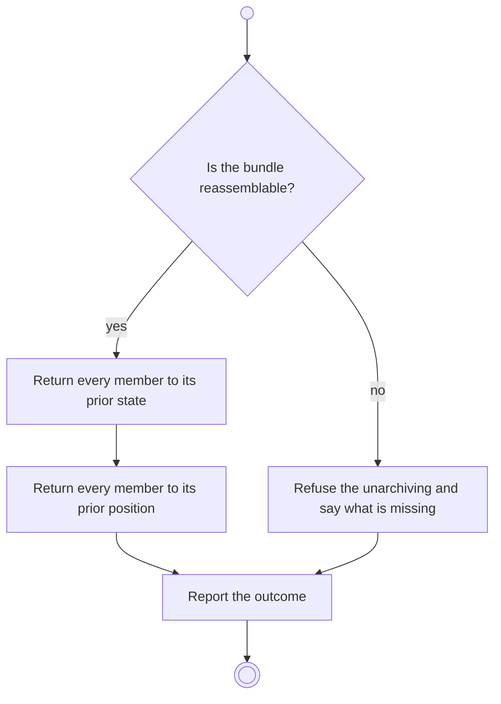

# BP15.03 — Unarchive an item

> GENERATED by `bpmn-dsl si-export` — do not edit; the source is the `call` block in the
> `.bpd` (#1182/ADR-068, keyed by call site per ADR-069).
>
> hash: `sha256:8fdc3d8337a432afd7f271a82291489635be07ed3e4250189822a4b2fa641c53`

## BP15_ReviewArchivedMaterial — Activity diagram

### Bound rules

| Where | Rule |
|---|---|
| "Is the bundle reassemblable?" | `BR-25` |
| Return every member to its prior position | `BR-88` |

### Messages

| Where | Message | To | Payload |
|---|---|---|---|
| Unarchive an item | The item back in the working set | User | — |

### Notes

- **Unarchive an item**: Ordering is relative, so the position an archived item comes back to was never occupied while it was away. The check-out record of a goal that comes back is untouched.
