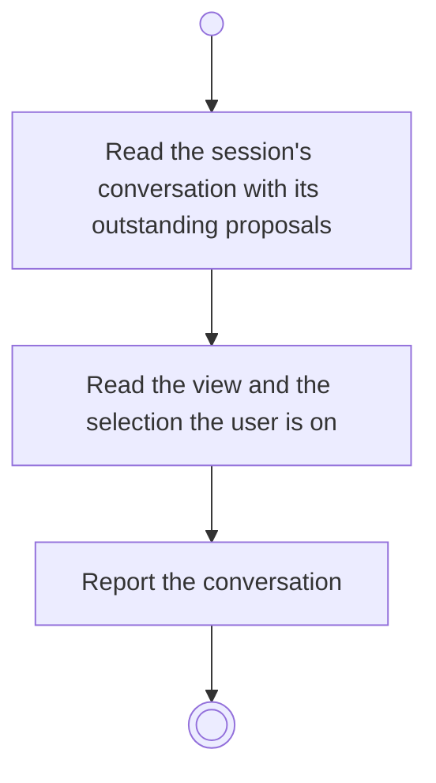

# BP16.01 — Open the advisor conversation

> GENERATED by `bpmn-dsl si-export` — do not edit; the source is the `call` block in the
> `.bpd` (#1182/ADR-068, keyed by call site per ADR-069).
>
> hash: `sha256:ffd355f4d8edf2794963efc08ad96406760e1b50be7efe558c30d45c2181049a`

## BP16_ConsultTheAdvisor — Activity diagram

### Bound rules

| Where | Rule |
|---|---|
| Read the session's conversation with its outstanding proposals | `BR-66` |

### Messages

| Where | Message | To | Payload |
|---|---|---|---|
| Open the advisor conversation | The conversation with its context | User | — |

### Notes

- **Open the advisor conversation**: There is one advisor and one conversation per session. The conversation is journaled and stays out of version control.
