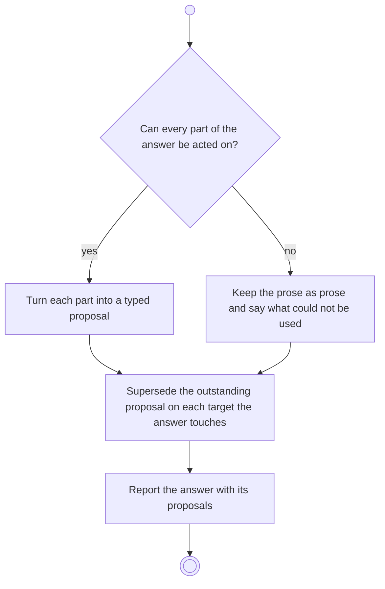

# BP16.03 — Take the advisor's answer

> GENERATED by `bpmn-dsl si-export` — do not edit; the source is the `call` block in the
> `.bpd` (#1182/ADR-068, keyed by call site per ADR-069).
>
> hash: `sha256:07a49d7a06f5c5b4925ec65fa1c2078076ce835a2d7ca5c3aab869a9c1d37bc0`

## BP16_ConsultTheAdvisor — Activity diagram

### Bound rules

| Where | Rule |
|---|---|
| "Can every part of the answer be acted on?" | `BR-75` |
| Turn each part into a typed proposal | `BR-68` |
| Keep the prose as prose and say what could not be used | `BR-75` |
| Supersede the outstanding proposal on each target the answer touches | `BR-70` |
| Report the answer with its proposals | `BR-118` |

### Messages

| Where | Message | To | Payload |
|---|---|---|---|
| Take the advisor's answer | The answer with its proposals | User | — |

### Notes

- **Take the advisor's answer**: A proposal is a structured object, never prose to be parsed. At most one proposal is outstanding per target, and an already-applied or already-dismissed one is closed and untouched.
