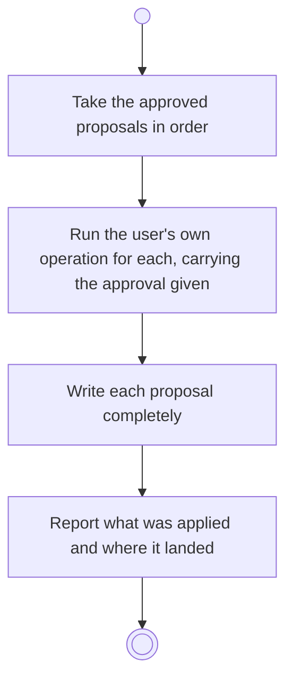

# BP16.04 — Apply advisor proposals

> GENERATED by `bpmn-dsl si-export` — do not edit; the source is the `call` block in the
> `.bpd` (#1182/ADR-068, keyed by call site per ADR-069).
>
> hash: `sha256:b286a67ba3944f9082c5b2875c16f497c4bc965091da101f1081e51ce76889cf`

## BP16_ConsultTheAdvisor — Activity diagram

### Bound rules

| Where | Rule |
|---|---|
| Take the approved proposals in order | `BR-71` |
| Run the user's own operation for each, carrying the approval given | `BR-72` |
| Write each proposal completely | `BR-69` |
| Report what was applied and where it landed | `BR-74` |

### Messages

| Where | Message | To | Payload |
|---|---|---|---|
| Apply advisor proposals | What was applied, and where | User | — |

### Notes

- **Apply advisor proposals**: One request applies a single proposal and a whole answer alike. There is no second write path: a proposal to create something carries everything that thing needs.
