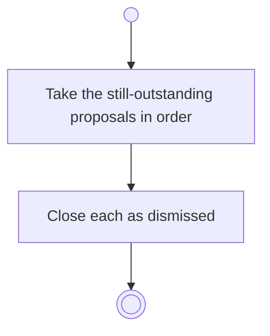

# BP16.05 — Dismiss advisor proposals

> GENERATED by `bpmn-dsl si-export` — do not edit; the source is the `call` block in the
> `.bpd` (#1182/ADR-068, keyed by call site per ADR-069).
>
> hash: `sha256:be80e0947c4964d9c7b66c9de5a07bbda0e5274d02abb82b877cef101d33e68c`

## BP16_ConsultTheAdvisor — Activity diagram

### Bound rules

| Where | Rule |
|---|---|
| Take the still-outstanding proposals in order | `BR-71` |
| Close each as dismissed | `BR-70` |

### Messages

| Where | Message | To | Payload |
|---|---|---|---|
| Dismiss advisor proposals | What was dismissed | User | — |

### Notes

- **Dismiss advisor proposals**: One request dismisses a single proposal and a whole answer alike. Already-resolved proposals are skipped.
