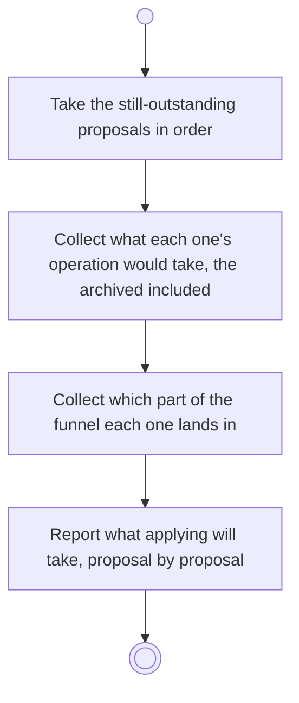

# BP16.07 — See what applying will take

> GENERATED by `bpmn-dsl si-export` — do not edit; the source is the `call` block in the
> `.bpd` (#1182/ADR-068, keyed by call site per ADR-069).
>
> hash: `sha256:78f943bffa279f6fc91860226858b2e1ee6935a5b7a8cd5695cdc1bdc276dcc1`

## BP16_ConsultTheAdvisor — Activity diagram

### Bound rules

| Where | Rule |
|---|---|
| Take the still-outstanding proposals in order | `BR-71` |
| Collect what each one's operation would take, the archived included | `BR-117` |
| Collect which part of the funnel each one lands in | `BR-74` |
| Report what applying will take, proposal by proposal | `BR-72` |

### Messages

| Where | Message | To | Payload |
|---|---|---|---|
| See what applying will take | What applying will take, and where it lands | User | — |

### Notes

- **See what applying will take**: A proposal that takes nothing has nothing to disclose. One that deletes or archives discloses exactly what the user's own gesture would, because it is that gesture.
