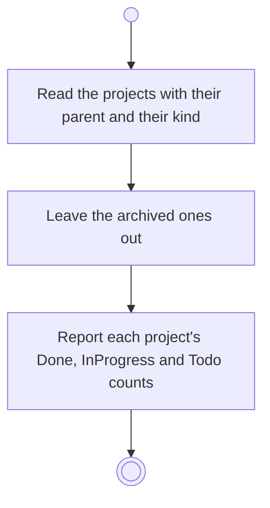

# BP17.01 — Read the project list

> GENERATED by `bpmn-dsl si-export` — do not edit; the source is the `call` block in the
> `.bpd` (#1182/ADR-068, keyed by call site per ADR-069).
>
> hash: `sha256:8dba95819e3ff007247e6678e7e7abac0f59183da58fec8500d385645f9e8028`

## BP17_MaintainAProject — Activity diagram

### Bound rules

| Where | Rule |
|---|---|
| Read the projects with their parent and their kind | `BR-96` |
| Leave the archived ones out | `BR-26` |
| Report each project's Done, InProgress and Todo counts | `BR-109` |

### Messages

| Where | Message | To | Payload |
|---|---|---|---|
| Read the project list | The projects with their parents and kinds | User | — |

### Notes

- **Read the project list**: A project with no parent is legitimate. The counts are of activities; a simple project has none.
