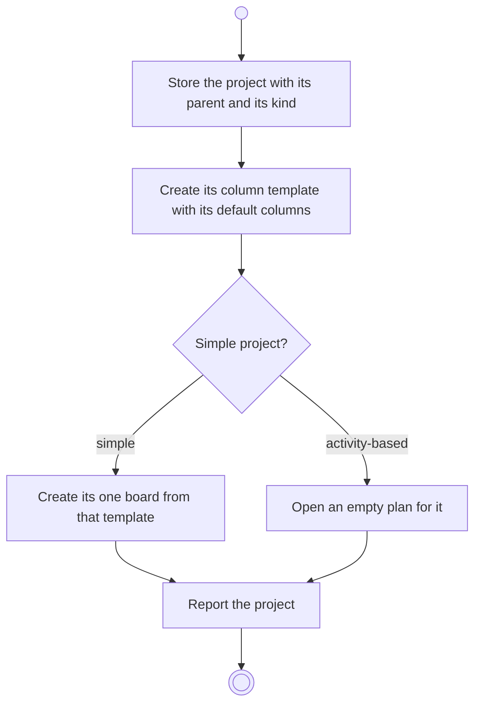

# BP17.02 — Create a project

> GENERATED by `bpmn-dsl si-export` — do not edit; the source is the `call` block in the
> `.bpd` (#1182/ADR-068, keyed by call site per ADR-069).
>
> hash: `sha256:2617ef1a8ace75b8358c63690339c6e47a876a924d4197e99c55c37a10e57b1c`

## BP17_MaintainAProject — Activity diagram

### Bound rules

| Where | Rule |
|---|---|
| Store the project with its parent and its kind | `BR-97` |
| Create its column template with its default columns | `BR-108` |
| "Simple project?" | `BR-97` |
| Create its one board from that template | `BR-101` |
| Open an empty plan for it | `BR-111` |

### Messages

| Where | Message | To | Payload |
|---|---|---|---|
| Create a project | Project created | User | — |

### Notes

- **Create a project**: One request creates either kind. The new template starts from the default columns, one Backlog and one Done among them. The kind is declared once and never migrates. A plan orders and tracks; it carries no duration, no float and no critical path.
