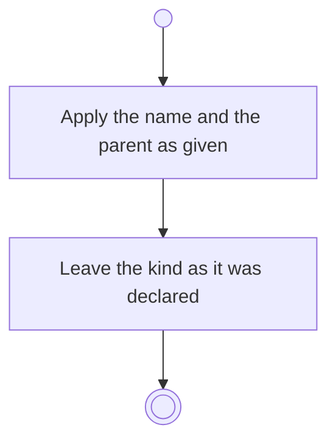

# BP17.03 — Amend a project

> GENERATED by `bpmn-dsl si-export` — do not edit; the source is the `call` block in the
> `.bpd` (#1182/ADR-068, keyed by call site per ADR-069).
>
> hash: `sha256:a2d52faa470e3432d6ee15c65ac9044b2ffe564db558c5efce053e2e3633d398`

## BP17_MaintainAProject — Activity diagram

### Bound rules

| Where | Rule |
|---|---|
| Apply the name and the parent as given | `BR-96` |
| Leave the kind as it was declared | `BR-97` |

### Messages

| Where | Message | To | Payload |
|---|---|---|---|
| Amend a project | Project amended | User | — |

### Notes

- **Amend a project**: The parent is single-valued and the user is never asked what kind of thing it is.
