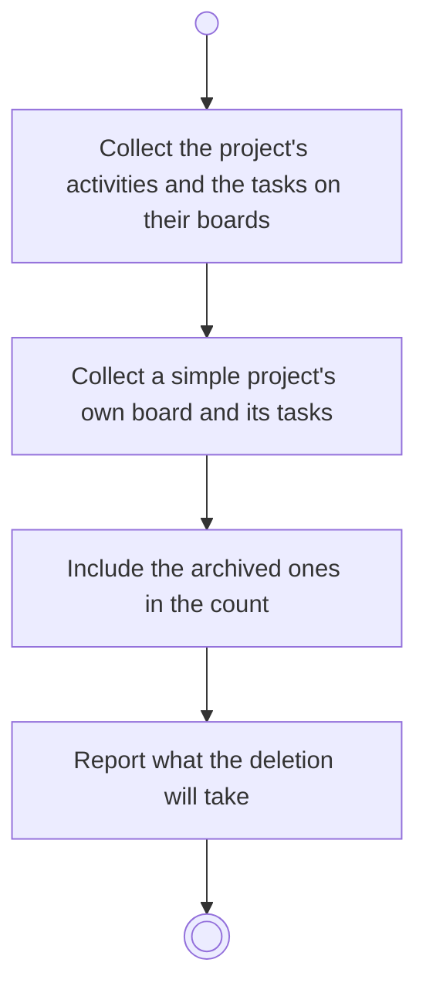

# BP17.04 — See what deleting a project takes

> GENERATED by `bpmn-dsl si-export` — do not edit; the source is the `call` block in the
> `.bpd` (#1182/ADR-068, keyed by call site per ADR-069).
>
> hash: `sha256:26f1abd12b7a38762cedc75b64ba06f2ba72e68031bc112541d53c5e52aaa77a`

## BP17_MaintainAProject — Activity diagram

### Bound rules

| Where | Rule |
|---|---|
| Collect the project's activities and the tasks on their boards | `BR-114` |
| Collect a simple project's own board and its tasks | `BR-101` |
| Include the archived ones in the count | `BR-117` |
| Report what the deletion will take | `BR-113` |

### Messages

| Where | Message | To | Payload |
|---|---|---|---|
| See what deleting a project takes | What the project deletion will take | User | — |

### Notes

- **See what deleting a project takes**: Everything the project is goes with it. Keeping anything below it is not offered, because nothing below a project can be detached.
