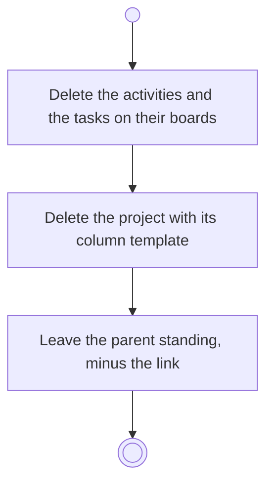

# BP17.05 — Delete a project

> GENERATED by `bpmn-dsl si-export` — do not edit; the source is the `call` block in the
> `.bpd` (#1182/ADR-068, keyed by call site per ADR-069).
>
> hash: `sha256:069e323d8cb5685f18b50a617ee1140f3636ff3f9321ad8577cfaf2a54365509`

## BP17_MaintainAProject — Activity diagram

### Bound rules

| Where | Rule |
|---|---|
| Delete the activities and the tasks on their boards | `BR-114` |
| Delete the project with its column template | `BR-108` |
| Leave the parent standing, minus the link | `BR-96` |

### Messages

| Where | Message | To | Payload |
|---|---|---|---|
| Delete a project | Project deleted | User | — |

### Notes

- **Delete a project**: The parent survives a project's deletion. A goal left with no linked idea is flagged on its current state.
