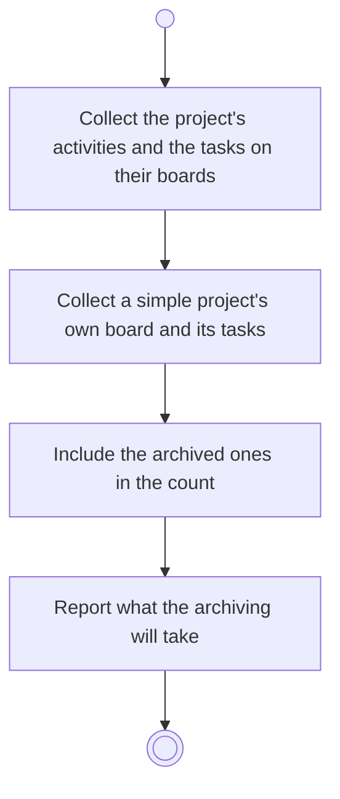

# BP17.14 — See what archiving a project takes

> GENERATED by `bpmn-dsl si-export` — do not edit; the source is the `call` block in the
> `.bpd` (#1182/ADR-068, keyed by call site per ADR-069).
>
> hash: `sha256:4a25a0fe3e548892b2a8a6773c47796fe7c02d5bc588fa80a8f2a597aa6d148c`

## BP17_MaintainAProject — Activity diagram

### Bound rules

| Where | Rule |
|---|---|
| Collect the project's activities and the tasks on their boards | `BR-112` |
| Collect a simple project's own board and its tasks | `BR-101` |
| Include the archived ones in the count | `BR-117` |
| Report what the archiving will take | `BR-113` |

### Messages

| Where | Message | To | Payload |
|---|---|---|---|
| See what archiving a project takes | What the archiving will take | User | — |

### Notes

- **See what archiving a project takes**: Archiving a project is the only way an activity is archived at all, and it is approved whole or rejected whole.
