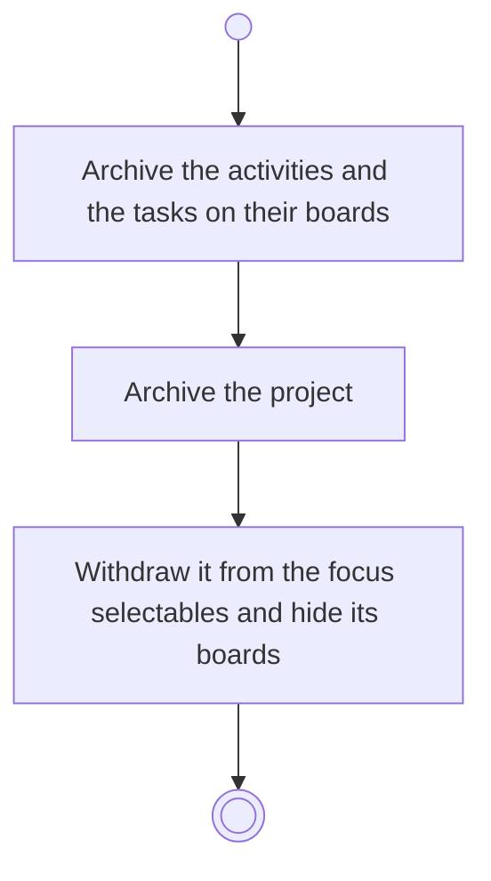

# BP17.15 — Archive a project

> GENERATED by `bpmn-dsl si-export` — do not edit; the source is the `call` block in the
> `.bpd` (#1182/ADR-068, keyed by call site per ADR-069).
>
> hash: `sha256:fd45a41b3db379b03aa2bbddbfcb51e8173ae7c91ad1f0dd624733a0286dffc3`

## BP17_MaintainAProject — Activity diagram

### Bound rules

| Where | Rule |
|---|---|
| Archive the activities and the tasks on their boards | `BR-112` |
| Archive the project | `BR-23` |
| Withdraw it from the focus selectables and hide its boards | `BR-43` |

### Messages

| Where | Message | To | Payload |
|---|---|---|---|
| Archive a project | Project archived | User | — |

### Notes

- **Archive a project**: An archived project is frozen until it is brought back, and it comes back as the whole bundle it went as.
