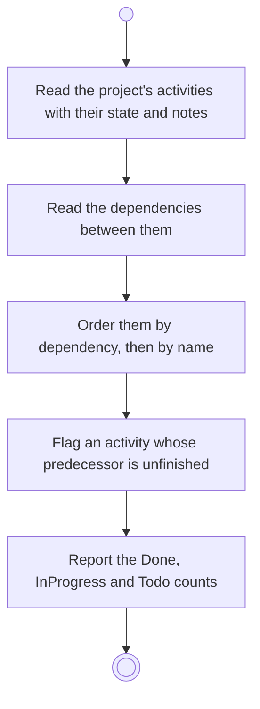

# BP18.01 — Read a project's course

> GENERATED by `bpmn-dsl si-export` — do not edit; the source is the `call` block in the
> `.bpd` (#1182/ADR-068, keyed by call site per ADR-069).
>
> hash: `sha256:95d1ec1e7c3eda7d6c17f05a226da2482dd7c363caa7b463b22e0c781eae180f`

## BP18_PlanAProjectsCourse — Activity diagram

### Bound rules

| Where | Rule |
|---|---|
| Read the project's activities with their state and notes | `BR-98` |
| Read the dependencies between them | `BR-99` |
| Order them by dependency, then by name | `BR-119` |
| Flag an activity whose predecessor is unfinished | `BR-110` |
| Report the Done, InProgress and Todo counts | `BR-109` |

### Messages

| Where | Message | To | Payload |
|---|---|---|---|
| Read a project's course | The graph with its states and counts | User | — |

### Notes

- **Read a project's course**: The result is a graph, not a chain: several activities may be ready at once. The flag names the predecessor and clears itself when that predecessor completes. A plan orders and tracks; it carries no duration, no float and no critical path.
